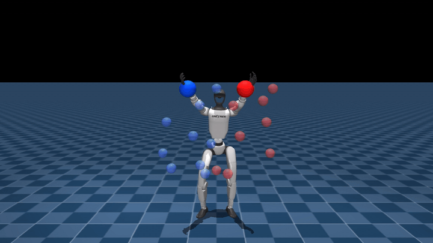

# unitree-g1-humanoid-reach

> **Standing bimanual reach for the Unitree G1.** The humanoid stays planted and brings both hands to sampled 3D targets covering symmetric/asymmetric pairs from below-waist to above-shoulders. Ships an RMA (Rapid Motor Adaptation) teacher-student variant for proprioception-only deployment.

[](LICENSE)
[](https://www.python.org/downloads/release/python-3100/)
[](https://github.com/google-deepmind/mujoco)
[](https://github.com/mujocolab/mjlab)
[](https://github.com/leggedrobotics/rsl_rl)
[](https://ashish-kmr.github.io/rma-legged-robots/)

<p align="center">
  
</p>
<p align="center"><sub>Trained reach policy: G1 standing in place and bringing both hands to sampled 3D targets across symmetric and asymmetric pairs.</sub></p>

## Overview

Standing bimanual reach policy trained with Proximal Policy Optimisation (PPO) in mjlab. Target pairs are drawn across the full workspace (below-waist to above-shoulders) under a tunable mirror probability, so the policy sees both symmetric and asymmetric reaches at a controlled ratio. A separate RMA (Kumar et al. 2021) teacher is trained with privileged dynamics (body mass, joint friction, external force applied to the base) and distilled into a proprioception-only student via a 1-D-conv adaptation module. The student runs at deployment with no privileged info.

Key properties:
- **Auxiliary branch** warm-started from walk; its arm manifold overlaps with pick's grasp approach, so the reach checkpoint can replace walk as a pick warm-start when the table geometry is already in-distribution.
- **Two policies, same MDP.** `policy_reach.py` defines the task; `policy_reach_rma.py` subclasses it and injects privileged observations for the RMA teacher.
- **Workspace coverage is tunable** via `REACH_SYMMETRY_PROB`.

Scope boundaries: no locomotion. The robot's base pose is held fixed. Pick/carry locomotion lives in the sibling repos.

## Prerequisites

- **Python 3.10 exactly** (notebook asserts this).
- **CUDA GPU.** Smoke run fits ~4 GB VRAM; full training is tuned for a NVIDIA B300 SXM6. Scale via `src/tiers.py`.
- **[uv](https://github.com/astral-sh/uv)** for pinned installs.
- **Headless MuJoCo:** `MUJOCO_GL=egl`.

## Quickstart (~5 min on a laptop GPU)

```bash
git clone https://github.com/narayanerm/unitree-g1-humanoid-reach.git
cd unitree-g1-humanoid-reach
uv pip install -r requirements.txt
jupyter lab 03a_reach_normal.ipynb
```

Set `DEBUG_LIGHT = True` in the first cell and Run All. Expect: a checkpoint under `outputs/logs/g1_reach/<timestamp>/` and climbing `Episode/rew_reach_dist` on TensorBoard.

## Full training

Two task variants:

| Notebook                   | Task ID            | Variant                                                  |
| -------------------------- | ------------------ | -------------------------------------------------------- |
| `03a_reach_normal.ipynb`   | `Mjlab-G1-Reach`   | Base reach, proprioception only.                         |
| `03b_reach_weight.ipynb`   | `Mjlab-G1-Reach`   | Base reach with domain randomisation on wrist payload.   |

Notebook flags: `REUSE_TRAINING`, `RESUME`, `WARM_START_FROM_WALK`, `DEBUG_LIGHT`.

**RMA teacher to student distillation.** Train the teacher first (privileged obs), then distill into a proprio-only student:

```python
from src.train_loop_rma import run as run_rma

run_rma(
    teacher_ckpt="outputs/logs/g1_reach_rma/<timestamp>/model_<N>.pt",
    log_dir="outputs/logs/g1_reach_rma_student/<timestamp>",
    num_envs=4096,
    max_iterations=500,
)
```

The student consumes a short window of proprioception, estimates a latent extrinsics vector via the adaptation module ([`src/rma.py`](src/rma.py)), and reproduces the teacher action distribution.

## Using the trained policy

**Load a checkpoint and run inference:**

```python
import torch
from rsl_rl.runners import OnPolicyRunner
from src.policy_reach import register, g1_reach_env_cfg

register()
env_cfg = g1_reach_env_cfg(play=True)
# Build env (see src/train_loop.py for the full wrapper) and load the actor:
state = torch.load("outputs/logs/g1_reach/<ts>/model_<N>.pt", map_location="cuda")
# state["model_state_dict"] holds the actor-critic weights.
```

**Inspect training curves:**

```bash
tensorboard --logdir outputs/logs/g1_reach*
```

## Repo layout

```
src/
  policy_reach.py        Base reach MDP + PPO cfg. TASK_ID = "Mjlab-G1-Reach".
  policy_reach_rma.py    Reach with privileged obs for the RMA teacher.
  rma.py                 Encoder + adaptation-module components (Kumar et al. 2021).
  train_loop.py          Standard PPO with shape-filtered warm-start.
  train_loop_rma.py      Student distillation loop for RMA.
  collect_buffer.py, utils.py, tiers.py   Shared infra (see walk repo for details).
03a_reach_normal.ipynb   Entry point: base reach.
03b_reach_weight.ipynb   Entry point: reach under payload weight variation.
outputs/
  logs/g1_reach/, g1_reach_rma/   Checkpoints + TB events (kept).
```

## Technology stack

| Component            | Choice                                                                                 |
| -------------------- | -------------------------------------------------------------------------------------- |
| Physics simulator    | MuJoCo Warp (GPU-parallel) via **mjlab**                                               |
| RL algorithm         | PPO (`rsl_rl`), adaptive LR, GAE(λ=0.95), clip=0.2                                     |
| Base policy          | 3-layer MLP (512-256-128, ELU)                                                         |
| Observation          | Proprioception + 6 D target (two 3 D hand targets)                                     |
| Action               | 29 D joint position targets                                                            |
| Teacher/student      | **RMA** (encoder on privileged dynamics + adaptation module on proprioception history) |
| Warm-start           | Shape-filtered load from walk + progressive layer unfreezing (Howard & Ruder, 2018)    |
| Domain randomisation | Wrist payload (`03b_reach_weight`), friction, encoder bias                             |
| Compute target       | 1x NVIDIA B300 SXM6 (tuned); scalable via `src/tiers.py`                               |

## Design decisions

- **Two policy files for one task.** `src/policy_reach.py` holds the base MDP; `src/policy_reach_rma.py` subclasses it and injects privileged observations (mass, friction, external disturbance) into the actor only during teacher training.
- **Adaptation module** ([`src/rma.py`](src/rma.py)) is a 1-D conv over proprioception history that regresses the privileged latent. The student can then be deployed with no privileged info at inference.
- **Symmetry sampling.** Target pairs are drawn with explicit mirror probability so the policy sees both symmetric reaches (both hands up) and asymmetric reaches (one up, one down) at a controlled ratio.
- **Transferable to pick.** The learned arm manifold overlaps enough with table-approach grasping that the reach checkpoint can replace walk as the pick warm-start when table geometry is already in-distribution.

## Troubleshooting

| Symptom                                           | Likely cause / fix                                                                                   |
| ------------------------------------------------- | ---------------------------------------------------------------------------------------------------- |
| `AssertionError: Python 3.10 required`            | Create a 3.10 venv (`uv venv --python 3.10`).                                                        |
| RMA student loss plateaus near teacher's        | Adaptation module too narrow or history too short; grow conv channels in `src/rma.py`.               |
| Teacher reward collapses mid-training             | Privileged obs scale drift. Enable `freeze_normalizer_after_warmup` in the PPO cfg.                 |
| OOM on 03b with payload DR                        | Reduce `NUM_ENVS` in `src/tiers.py`; DR broadens the dynamics distribution and uses more VRAM.       |

## Pipeline position

Auxiliary branch warm-started from walk; its checkpoint can seed pick:

```
WALK  --warm-start-->  REACH (here, + RMA student)
                          |
                          v
                       alt warm-start for PICK
```

| Repo | Role |
| --- | --- |
| [walk](../unitree-g1-humanoid-walk) | Base locomotion, upstream warm-start |
| **[reach](.)** ← you are here | Standing bimanual reach (+ RMA student) |
| [pick](../unitree-g1-humanoid-pick) | Walk to table + grasp (alt warm-start from reach) |
| [carry](../unitree-g1-humanoid-carry) | Walk while carrying |
| [place](../unitree-g1-humanoid-place) | Set the carried box down |
| [fsm](../unitree-g1-humanoid-fsm) | Chain experts into a unified BC dataset |
| [monolithic-policy](../unitree-g1-humanoid-monolithic-policy) | Single MLP end-to-end alternative |

## Citation

```bibtex
@misc{medeiros2026g1reach,
  author       = {Ribeiro Medeiros, Narayane},
  title        = {unitree-g1-humanoid-reach: standing bimanual reach for the Unitree G1 with RMA distillation},
  year         = {2026},
  howpublished = {\url{https://github.com/narayanerm/unitree-g1-humanoid-reach}}
}
```

RMA reference:

```bibtex
@inproceedings{kumar2021rma,
  author    = {Kumar, Ashish and Fu, Zipeng and Pathak, Deepak and Malik, Jitendra},
  title     = {{RMA}: Rapid Motor Adaptation for Legged Robots},
  booktitle = {Robotics: Science and Systems (RSS)},
  year      = {2021}
}
```

## Author & License

**Narayane Ribeiro Medeiros**, Instituto Tecnológico de Aeronáutica.
[GitHub](https://github.com/narayanerm) | [LinkedIn](https://www.linkedin.com/in/narayanerm) | narayane.rm@gmail.com

Released under the [MIT License](LICENSE).
